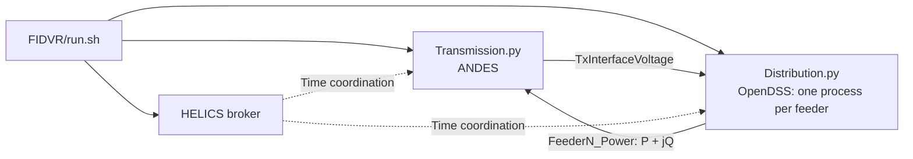

# Project Walkthrough

## Goal

The `FIDVR/` scenario studies fault-induced delayed voltage recovery with ANDES
transmission dynamics, the OpenDSS IEEE 13-node feeder, and HELICS coordination.
The simulators exchange transmission interface voltage and total feeder
active/reactive power at each co-simulation step. The feeder represents selected
air-conditioner loads with the WECC/LD1PAC Motor D model.

Start with the [root README](README.md#quick-start) for environment setup and a
short baseline run. All commands below run from `FIDVR/` in an activated Python
environment. The runnable entry points are in that directory, rather than the
repository root.

## Entry points

| Component | Role |
| --- | --- |
| [FIDVR/run.sh](FIDVR/run.sh) | Launches the HELICS broker, transmission process, and one or more feeder processes. `PYTHON` selects their interpreter; `RUN_OUTPUT_DIR` selects the log directory. |
| [FIDVR/Transmission.py](FIDVR/Transmission.py) | Applies the configured disturbance, receives feeder `P/Q`, advances ANDES, and publishes interface voltage. |
| [FIDVR/Distribution.py](FIDVR/Distribution.py) | Receives transmission voltage, updates feeder load/control states, solves OpenDSS, and publishes feeder `P/Q`. |
| [FIDVR/plot_from_logs.py](FIDVR/plot_from_logs.py) | Produces transmission voltage, load, and alert plots from logs. |
| [FIDVR/plot_distribution_from_logs.py](FIDVR/plot_distribution_from_logs.py) | Produces distribution voltage, Motor D trajectory, and alert plots from logs. |
| [FIDVR/fidvr_alerts.py](FIDVR/fidvr_alerts.py), [fidvr_controls.py](FIDVR/fidvr_controls.py), [fidvr_load_restoration.py](FIDVR/fidvr_load_restoration.py) | Support alert detection, delayed controls, and optional thermal load restoration. |
| [WECC_MOTOR_D_TRACEABILITY.md](WECC_MOTOR_D_TRACEABILITY.md) | Maps the Motor D implementation to the WECC report and identifies model extensions. |

Shared feeder cases are stored in the repository's `13Bus/` and `8500Node/`
directories. The FIDVR baseline uses `../13Bus/IEEE13Nodeckt.dss` and its local
`ieee14_fault.xlsx` transmission case.

## Runtime data flow



The transmission process receives each feeder's power and updates its ANDES
load injection. It advances the dynamic simulation to the HELICS-granted time
and publishes interface voltage. Each feeder applies that voltage to its OpenDSS
source, updates load/control states, solves a snapshot, and publishes total
feeder power. HELICS iterative exchange coordinates the interface voltage and
power before time advances.

## Motor D model flow

1. Read load, regulator, and capacitor data from the IEEE 13-node feeder.
2. With `FIDVR_ENABLE=1`, split selected loads into their remaining static portion
   and a controlled `Load.weccmd_*` Motor D injection.
3. Read the latest interface voltage and calculate motor terminal voltages.
4. Update running/stalled states and timers, contactor dropout/reclose, thermal
   protection, undervoltage relay behavior, and the restartable fraction using
   the Motor D parameters.
5. Edit the same controlled load elements to apply each motor group's current
   active/reactive power. Apply regulator/capacitor controls and post-thermal
   restoration only when their options are enabled.
6. Solve the feeder and return its total `P/Q` to ANDES.

The [traceability table](WECC_MOTOR_D_TRACEABILITY.md) distinguishes the strict
WECC Motor D equations from the optional post-thermal restoration extension.
The [FIDVR guide](FIDVR/README.md) documents profile and parameter choices.

## Run a fault study

After the short baseline completes, the `weak_bus14` profile provides a compact
fault-study starting point. From `FIDVR/`:

```bash
PYTHON=python RUN_OUTPUT_DIR=runs/weak_bus14_demo TARGET_TIME=10 \
  FIDVR_ENABLE=1 FIDVR_PROFILE=weak_bus14 FIDVR_MOTOR_SHARE=1.0 \
  TX_ENABLE_DISTURBANCE=1 bash ./run.sh
```

This enables the Motor D model and the transmission disturbance at the bus 14
interface. Use a distinct `RUN_OUTPUT_DIR` for each comparison.

Generate plots from the new logs using the same environment:

```bash
python plot_from_logs.py --log runs/weak_bus14_demo/transmission.log --bus 14
python plot_distribution_from_logs.py --log runs/weak_bus14_demo/feeder_1.log
```

The plot scripts default to writing into the log's directory. Useful artifacts
in `FIDVR/runs/weak_bus14_demo/` include:

| Artifact | What to inspect |
| --- | --- |
| `transmission.log` | Fault settings, interface voltage, and feeder power feedback |
| `feeder_1.log` | Feeder settings, motor states, `MotorP`/`MotorQ`, and FIDVR stages |
| `total_pq_and_bus14_voltage_vs_time.png` | Transmission-side voltage and aggregate load response |
| `feeder_1_distribution_bus_voltage_vs_time.png` | Monitored feeder voltage and stage intervals |
| `feeder_1_fidvr_trajectory.png` | Motor/control-state trajectory |

## Saved simulation result

The [README figure](FIDVR/feeder_1_distribution_bus_voltage_vs_time.png) comes
from the saved 10-second case documented in [transmission.log](FIDVR/transmission.log)
and [feeder_1.log](FIDVR/feeder_1.log), rather than the short baseline.

| Saved setting | Value |
| --- | --- |
| Transmission/feeder cases | IEEE 14-bus / IEEE 13-node |
| Transmission interface and fault bus | 14 |
| Fault | Three-phase bus fault, 1.000–1.080 s, `rf=0`, `xf=0.3` |
| Feeder voltage monitor | Bus 675, average voltage in the plotted curve |
| Co-simulation base | 100 MVA |
| Motor model | WECC Motor D enabled |
| Regulator/capacitor control | Disabled |
| Optional post-thermal restoration | Disabled |

The fault causes the initial dip. After clearing, the saved curve remains below
its pre-fault level, with motor-stalling and thermal-trip intervals shown on
the lower timeline. The alert thresholds are referenced to the initialization
voltage.

For broader comparisons, see the [case-study observations](FIDVR/case_study_observations_conclusions.md)
and the sweep/plot entry points in `FIDVR/`. Those notes include motor-share and
fault-location comparisons, model limitations, and the settings used for
accelerated restoration demonstrations.
