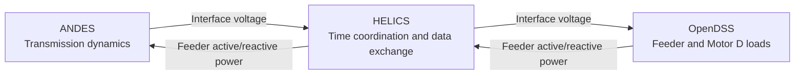
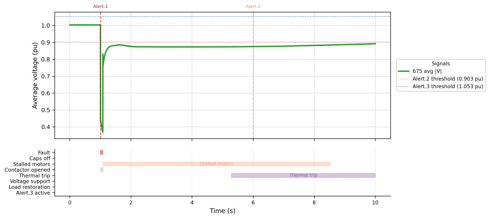

# Transmission–Distribution Co-Simulation

**ANDES · OpenDSS · HELICS | Power systems research at NC State**

A Python framework for studying how transmission disturbances affect distribution
feeders and how feeder loads feed back into transmission dynamics. The main study
couples an IEEE 14-bus transmission system with an IEEE 13-node feeder to examine
fault-induced delayed voltage recovery (FIDVR): voltage can remain depressed
after a fault clears when air-conditioner motors stall.

## My contributions

- Connected ANDES transmission dynamics and OpenDSS feeder models through HELICS,
  exchanging interface voltage and feeder active/reactive power with iterative
  time coordination.
- Implemented a WECC/LD1PAC Motor D load representation using controlled OpenDSS
  injections, including stalling, protection, thermal trip, and restart behavior.
- Built study workflows and diagnostics for motor-share sensitivity, fault
  location/type, and feeder-level voltage recovery, with parameter traceability
  to the WECC model documentation.

## Architecture



The feeder solves its network and updates load states at each co-simulation
step. HELICS coordinates the simulators while voltage and power are iterated
before advancing time. See the [project walkthrough](PROJECT_WALKTHROUGH.md)
for the code entry points and model flow.

## Example study output



**Saved 10-second study:** an IEEE 14-bus three-phase fault at transmission bus 14
starts at 1.000 s and clears at 1.080 s (`rf=0`, `xf=0.3`). The figure monitors
average voltage at feeder bus 675 on a 100 MVA co-simulation base. WECC Motor D is
enabled; regulator/capacitor controls and the optional thermal restoration
extension are disabled. The voltage remains below its pre-fault level after
clearing, alongside the stalled-motor and thermal-trip intervals shown below the
curve. Settings are recorded in the saved [transmission log](FIDVR/transmission.log)
and [feeder log](FIDVR/feeder_1.log).

The [case-study notes](FIDVR/case_study_observations_conclusions.md)
describe further sensitivity studies and their modeling limits. The quick start
below runs a separate short baseline with disturbances and Motor D disabled.

## Repository guide

| Directory | Purpose | Start here |
| --- | --- | --- |
| `FIDVR/` | IEEE 14-bus/IEEE 13-node dynamic coupling, WECC Motor D, voltage-recovery scenarios | [FIDVR guide](FIDVR/README.md) |
| `Dynamic_Cosim/` | Transmission–distribution dynamic co-simulation scenarios | [Dynamic guide](Dynamic_Cosim/README.md) |
| `Steady_State_Cosim/` | Steady-state transmission–distribution coupling | [Steady-state guide](Steady_State_Cosim/README.md) |
| `Andes_118_power_flow_test/` | IEEE 118-bus case conversion and power-flow comparisons | [Power-flow notebook](Andes_118_power_flow_test/run_ieee118_in_andes.ipynb) |
| `13Bus/`, `8500Node/` | Shared distribution benchmark data | Scenario guides above |

Each co-simulation scenario has its own launcher. Run the launcher from its
scenario directory; there is no repository-root `run.sh`.

## Quick start

Use Linux or WSL with Bash, Python 3.11, and `ss` (provided by `iproute2`).
From the repository root, create an
environment and install the simulation/plotting packages:

```bash
python3.11 -m venv .venv
source .venv/bin/activate
python -m pip install helics helics-apps andes opendssdirect.py numpy pandas matplotlib openpyxl
```

Run the short IEEE 14-bus/IEEE 13-node baseline from `FIDVR/`:

```bash
cd FIDVR
PYTHON=python RUN_OUTPUT_DIR=runs/quickstart TARGET_TIME=2 \
  FIDVR_ENABLE=0 TX_ENABLE_DISTURBANCE=0 bash ./run.sh
```

`PYTHON` selects the interpreter used by the broker and simulator processes. Use
`PYTHON=/absolute/path/to/your/environment/bin/python` for another environment;
the launcher defaults to `python3`. The baseline uses transmission interface
bus 2, feeder monitor bus 650, and a 100 MVA base. New logs go to
`FIDVR/runs/quickstart/`.

From the same directory and activated environment, plot the new logs:

```bash
python plot_from_logs.py --log runs/quickstart/transmission.log
python plot_distribution_from_logs.py --log runs/quickstart/feeder_1.log
```

Plots are written alongside those logs. For fault studies, Motor D presets,
time-step controls, and longer demonstrations, follow the
[FIDVR guide](FIDVR/README.md) and [walkthrough](PROJECT_WALKTHROUGH.md).

### Containers

The container recipes live in the scenario directories but require the full
repository as their build context so shared feeder data is included. From the
repository root:

```bash
docker build -f FIDVR/Dockerfile -t andes-opendss-helics-cosim .
docker run --rm -it \
  -e TARGET_TIME=2 -e FIDVR_ENABLE=0 -e TX_ENABLE_DISTURBANCE=0 \
  -e RUN_OUTPUT_DIR=runs/quickstart \
  -v "$PWD":/workspace/Andes_OpenDSS_HELICS_CoSim_NCSU \
  andes-opendss-helics-cosim
```

The bind mount preserves the new logs on the host. For Apptainer, also build
from the repository root:

```bash
apptainer build andes-opendss-helics-cosim.sif FIDVR/Apptainer.def
TARGET_TIME=2 FIDVR_ENABLE=0 TX_ENABLE_DISTURBANCE=0 \
  RUN_OUTPUT_DIR=runs/quickstart \
  apptainer run --bind "$PWD":/workspace/Andes_OpenDSS_HELICS_CoSim_NCSU \
  andes-opendss-helics-cosim.sif
```

See the [FIDVR container instructions](FIDVR/README.md) for environment
overrides and interactive use.

## Model documentation

- [WECC Motor D traceability](WECC_MOTOR_D_TRACEABILITY.md): implemented equations,
  parameters, and the optional thermal load restoration extension.
- [FIDVR redesign guide](FIDVR/FIDVR_REDESIGN_GUIDE.md): model and study details.
- [Case-study observations](FIDVR/case_study_observations_conclusions.md): saved
  scenario observations, sensitivity comparisons, and future calibration work.

The optional post-thermal load restoration extension is separate from the
strict WECC Motor D core. Accelerated restoration demonstrations should be
interpreted using the study settings documented in the case notes.
